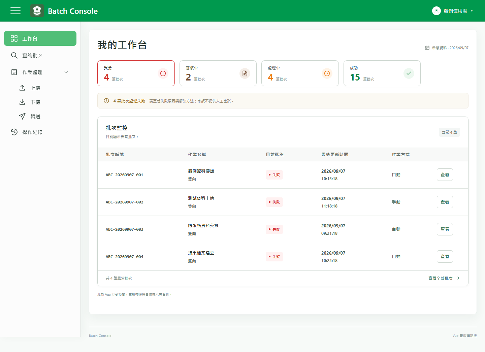

# Batch Console

批次作業管理前端，用來查看作業狀態、依編號關鍵字與日期尋找批次，並追蹤處理流程、執行明細及操作紀錄。



## 目前狀態

目前為可在本機操作的 Vue 3 示範專案，資料流程為：

```text
Vue 3 畫面
  → 共用批次邏輯與記憶體操作紀錄
  → 虛構範例資料
```

包含工作台、查詢批次、上傳、下傳、轉送與操作紀錄六個畫面。批次資料與操作紀錄在重新載入後恢復範例狀態；檔案作業只在瀏覽器中模擬，尚未串接後端、正式認證、資料庫或實際傳輸服務。

## 功能

- 工作台：依異常、審核中、處理中與成功四種狀態篩選批次；沿用原花朵 logo，側欄不重複顯示品牌標題。
- 查詢批次：支援編號關鍵字模糊查詢，忽略英文大小寫及前後空白，可合併最後更新日期篩選，每頁最多 20 筆。
- 流程明細：呈現手動／自動、單向／雙向共六種流程，以及每次執行的結果、失敗原因與示例處理方式。
- 取消上傳：手動上傳在審核完成前可取消，保留批次並新增操作紀錄。
- 上傳：選擇本機檔案、確認作業、建立示範 DAT 檔名並預覽文字內容。
- 下傳：以分頁清單選取多筆示範檔案並顯示處理結果。
- 轉送：選擇作業與本機檔案，確認後顯示示範結果與文字預覽。
- 操作紀錄：由新到舊顯示批次異動及成功的上傳、下傳、轉送，包含檔名與完成時間；多檔下傳合併一筆，支援日期篩選及分頁。有關聯批次就顯示原編號，沒有才顯示「—」。
- 作業通知：下傳與取消上傳完成後在右上角顯示通知；上傳、轉送則在關閉檔案預覽並返回清單後顯示成功通知，約 3 秒後自動消失。查看全部、前 10 行或後 10 行時不顯示成功通知。
- 響應式介面：支援桌面與窄螢幕版面。

## 技術棧

| 層級 | 技術 | 鎖定版本 | 套件授權 |
| --- | --- | --- | --- |
| 前端 | Vue 3 | 3.5.42 | MIT |
| 路由 | Vue Router | 4.6.4 | MIT |
| 開發與建置 | Vite | 6.4.3 | MIT |
| Vue 編譯整合 | @vitejs/plugin-vue | 5.2.4 | MIT |
| 邏輯測試 | Node.js 內建 test runner | 隨 Node.js | — |
| 畫面驗證 | Chromium / Chrome DevTools Protocol | 使用本機瀏覽器 | — |

套件版本與完整性雜湊以 [package-lock.json](package-lock.json) 為準。

## 專案結構

```text
src/
  assets/       頁首圖案
  components/   共用畫面元件
  data/         虛構展示資料
  layouts/      共用頁面配置
  lib/          批次、日期與檔案預覽邏輯
  router/       頁面路由
  services/     共用記憶體操作紀錄
  styles/       全域樣式
  views/        六個功能頁面
scripts/        瀏覽器流程驗證
tests/          Node.js 測試
screenshots/    README 畫面
```

## 本機開發

使用 Node.js 24（[.nvmrc](.nvmrc)）與 npm。專案也接受 Node.js 22，版本範圍見 [package.json](package.json)。

安裝依賴時應使用鎖定檔：

```sh
npm ci
```

啟動本機開發伺服器：

```sh
npm run dev
```

開啟 [http://127.0.0.1:5173](http://127.0.0.1:5173)，根路徑會導向 `/workbench`。若預設連接埠已被使用，請以啟動訊息中的網址為準。

Windows PowerShell 若限制執行 `npm.ps1`，可使用同一 npm 的 `npm.cmd` 執行上述命令。

## 頁面路由

| 路徑 | 畫面 |
| --- | --- |
| `/workbench` | 工作台 |
| `/search` | 查詢批次與階段明細 |
| `/operation/upload` | 上傳 |
| `/operation/download` | 下傳 |
| `/operation/transfer` | 轉送 |
| `/logs` | 操作紀錄 |

## 測試

邏輯與回歸測試：

```sh
npm test
```

正式建置：

```sh
npm run build
```

瀏覽器流程測試：先讓開發伺服器執行於 `http://127.0.0.1:5173`，再以獨立暫存設定啟動 Chromium 相容瀏覽器，開啟 `127.0.0.1:9223` 除錯連接埠及一個空白頁籤。測試使用固定示例日期，請勿連到日常使用的瀏覽器設定。

```sh
npm run test:browser
npm run test:browser:upload
```

兩個瀏覽器命令會控制同一個測試頁籤，請依序執行。第一個驗證工作台、查詢、流程、取消上傳通知、跨頁多檔下傳紀錄與響應式版面；第二個驗證上傳與轉送的確認、延後成功通知、DAT 檔名、文字預覽，以及成功、失敗、取消與預覽操作的紀錄差異。測試產物寫入已忽略的 `artifacts/` 目錄。

## 驗收規則

<details>
<summary>批次關鍵字查詢</summary>

已確認的批次關鍵字驗收情境：

| Given 前提 | When 操作 | Then 預期結果 |
| --- | --- | --- |
| 批次編號包含輸入的文字 | 輸入任一段編號並查詢 | 忽略英文大小寫與前後空白，顯示符合的批次；單筆結果沿用直接開啟明細 |
| 已套用日期與關鍵字 | 查詢或清空關鍵字後提交 | 兩條件取交集；清空關鍵字仍保留日期 |
| 查詢結果位於第二頁 | 提交新條件 | 回到第一頁 |
| 已套用查詢條件與頁碼 | 查看明細後返回，或在明細調整日期 | 返回保留條件與頁碼；調整日期仍使用原關鍵字並回第一頁 |
| 沒有符合的批次 | 查詢或按「顯示全部」 | 查無時顯示提示；「顯示全部」清除編號與日期條件 |

</details>

<details>
<summary>成功通知與操作紀錄</summary>

| 操作 | 成功通知 | 操作紀錄 |
| --- | --- | --- |
| 上傳／轉送 | 關閉全部／前 10 行／後 10 行預覽並返回清單後才顯示 | 作業成功當下記一筆，包含來源檔名、請求檔名及完成時間 |
| 下傳 | 成功後顯示完成筆數 | 本次全部所選檔名與完成時間合併記一筆 |
| 取消既有批次上傳 | 成功後顯示原批次編號 | 保留原批次編號並記一筆取消紀錄 |
| 失敗／放棄確認 | 失敗顯示錯誤通知；放棄確認不顯示成功通知 | 不記錄 |
| 查詢／切換預覽／關閉預覽 | 查看預覽時不顯示成功通知，關閉後依上列規則顯示 | 不新增或重複紀錄 |

成功通知約 3 秒後自動消失。操作紀錄沿用批次編號、操作紀錄、時間三欄，來源頁面併在操作內容中顯示。

有關聯批次編號時保留原編號，**只有沒有關聯批次編號才顯示「—」**。目前上傳、下傳與轉送頁未建立關聯批次，因此顯示「—」；不為了填欄位產生虛構批次。

</details>

## 文件與實作依據

本 README 提供公開功能與驗收摘要；內部規格及開發歷程文件依既有範圍保留於本機，不納入此 repository。下列來源可對照目前行為：

- [頁面路由](src/router/index.js)：畫面入口與標題。
- [批次共用邏輯](src/lib/core.js)：模糊查詢、分頁、取消資格與執行次數。
- [流程與查詢測試](tests/workflows.test.js)：共用邏輯驗收。
- [瀏覽器回歸腳本](scripts/verify-browser.cjs)：實際畫面操作與關鍵字情境。
- [上傳與轉送流程驗證](scripts/verify-upload-browser.cjs)：延後通知、檔案確認、預覽與操作紀錄。

## 範圍與資料

- 所有批次編號、作業代碼、名稱、時間與紀錄皆為虛構展示資料，請勿加入真實資料、帳密、Token、金鑰或 `.env`。
- 選取的檔案只在目前瀏覽器頁面中讀取及預覽；程式不會傳送至外部服務。
- 目前會一次讀取完整檔案，且未設定大小上限，只適合小型示範檔案。
- 操作紀錄只保存在目前頁面的記憶體中；重新載入後會回到初始範例。
- DAT 每日流水號保存在瀏覽器 `localStorage`，僅供示範檔名產生。
- 專案沒有實作正式登入、授權或存取控制。

導入受控環境前，需確認 Node.js、直接與間接套件及原生建置元件的使用規範，透過核准的套件來源執行 `npm ci`，並重新執行 `npm audit` 保存結果。請勿任意更新鎖定檔。

## 授權

此 repository 目前未附開源授權。公開瀏覽不代表取得複製、修改或散布權利；若需使用，請先取得權利人同意。
